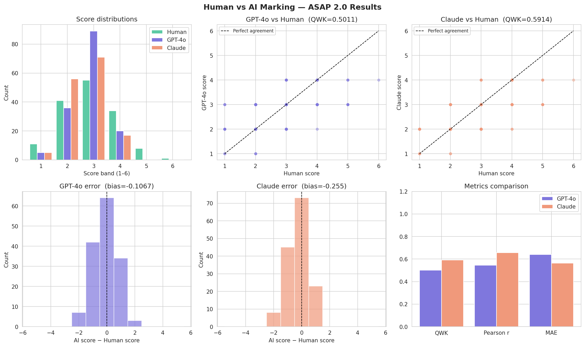

# Human vs AI Marking: Can LLMs Mark Student Essays Like Teachers?

MSc Artificial Intelligence dissertation project, University of Greater Manchester (awarded Distinction).

This project measures how closely two large language models, **GPT-4o** and **Claude Sonnet 4.5**, agree with human examiners when marking student essays holistically on a 1–6 scale. It uses 150 essays from the **ASAP 2.0** automated essay scoring dataset.



---

## Research question

How well do general-purpose LLMs agree with trained human raters when marking student writing, and do they show systematic bias (marking too harshly or too generously)?

---

## Method

1. **Sample:** 150 essays drawn from ASAP 2.0, stratified by human score band so the sample mirrors the dataset's score distribution. The essays cover 7 writing prompts, such as *Driverless cars*, *Exploring Venus* and *Car-free cities*.
2. **Marking:** each essay is sent to GPT-4o and to Claude with the same system prompt: a 1–6 holistic rubric, plus an instruction to return a JSON score and a one-sentence justification.
3. **Comparison:** AI scores are compared against the human score using:
   - **Quadratic Weighted Kappa (QWK):** the standard agreement measure in automated essay scoring
   - **Pearson correlation**
   - **Mean Absolute Error (MAE)**
   - **Mean bias:** whether the AI marks higher or lower than humans on average
   - Exact agreement and agreement within one mark

---

## Results

| Metric | GPT-4o | Claude Sonnet 4.5 |
|---|---|---|
| Essays scored | 150 | 149* |
| **Quadratic Weighted Kappa** | 0.50 (moderate) | **0.59** (moderate) |
| Pearson r | 0.55 | **0.66** |
| Mean Absolute Error | 0.64 | **0.56** |
| Mean bias | −0.11 (slight under-marking) | −0.26 (under-marking) |
| Exact agreement | 42.7% | **49.0%** |
| Within one mark | 93.3% | **94.6%** |

\* One Claude response could not be read as valid JSON and was excluded.

Full figures are in [`metrics_summary.txt`](metrics_summary.txt), and every essay's scores and justifications are in [`results_raw.csv`](results_raw.csv).

### Key findings

- **Claude agreed more closely with human markers than GPT-4o on every measure**, but both reached only *moderate* agreement (QWK 0.40–0.59). That is below the level usually expected before automated marking is used for real assessment.
- **Both models stay within one mark of the human score over 93% of the time**, so large disagreements are rare.
- **Both models compress scores towards the middle.** Neither model gave a single 5 or 6, even though human examiners awarded those to 9 essays, so the strongest writing was consistently under-marked.
- **Both models under-mark on average**, with Claude the harsher of the two.

---

## Limitations

- 150 essays is a modest sample, and each essay was marked once by each model.
- GPT-4o was run at temperature 0; Claude used its default temperature, so repeated Claude runs may vary slightly.
- The models received the prompt title rather than the full task instructions and source texts, and essays were truncated at 4,000 characters.
- Agreement is measured against the single score supplied in the dataset.

---

## Running the pipeline

```bash
pip install -r requirements.txt
```

**Recompute the metrics and charts from the saved results** (no API keys needed):

```bash
python asap_dissertation_pipeline.py --analyse-only
```

**Run the full pipeline** (calls the OpenAI and Anthropic APIs; costs apply):

1. Download `ASAP_2_Final_github_train.csv` from the [ASAP 2.0 repository](https://github.com/scrosseye/ASAP_2.0) and place it in this folder.
2. Set your API keys as environment variables, never in the code:
   ```bash
   # macOS / Linux
   export OPENAI_API_KEY="your-key"
   export ANTHROPIC_API_KEY="your-key"
   ```
   ```powershell
   # Windows PowerShell
   $env:OPENAI_API_KEY="your-key"
   $env:ANTHROPIC_API_KEY="your-key"
   ```
3. Run:
   ```bash
   python asap_dissertation_pipeline.py
   ```

---

## Files

| File | Contents |
|---|---|
| `asap_dissertation_pipeline.py` | Sampling, LLM marking, metrics and charts |
| `results_raw.csv` | The 150 essays with human, GPT-4o and Claude scores and justifications |
| `results_analysis.csv` | As above, plus per-essay error columns |
| `metrics_summary.txt` | Summary of all metrics |
| `results_charts.png` | Score distributions, scatter plots, error distributions and metric comparison |

---

## Data

Essays and human scores are from **ASAP 2.0** (Automated Student Assessment Prize 2.0), released under the [CC BY 4.0](https://creativecommons.org/licenses/by/4.0/) licence. See the [ASAP 2.0 repository](https://github.com/scrosseye/ASAP_2.0) for the dataset and its citation. The full dataset is not included here.

## Author

**Aniqa Arooj**, MSc Artificial Intelligence, University of Greater Manchester
